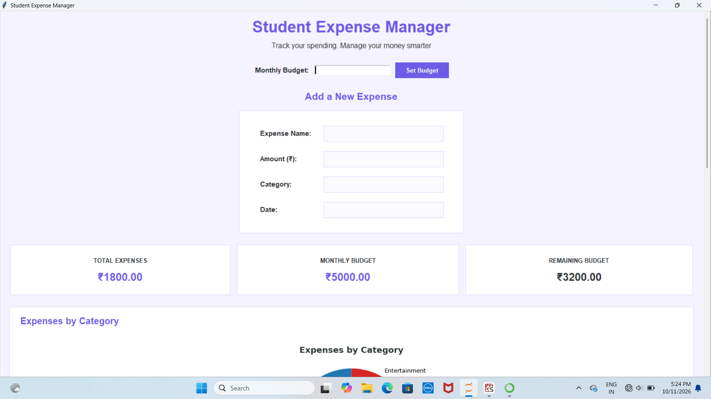

Student Expense Manager

A Python-based desktop application designed to help students manage their expenses, track their budgets, and monitor their spending.

Features

- Add and manage expenses
- Edit and delete expense records
- Categorize expenses
- Record expense dates
- View total expenses
- Set a budget and track the remaining balance
- View expense data through a chart
- Store expense records using SQLite

Technologies Used

- Python
- Tkinter
- SQLite
- Matplotlib

How to Run

1. Install Python on your computer.
2. Install Matplotlib if it is not already installed:
   "pip install matplotlib"
3. Download or clone this repository.
4. Run the main Python file:
   "python "expense manager.py""

Project Purpose

This project was developed to practice Python programming, graphical user interface development, database operations, and expense management.

Screenshots

Author

Rakshita Malvankar
